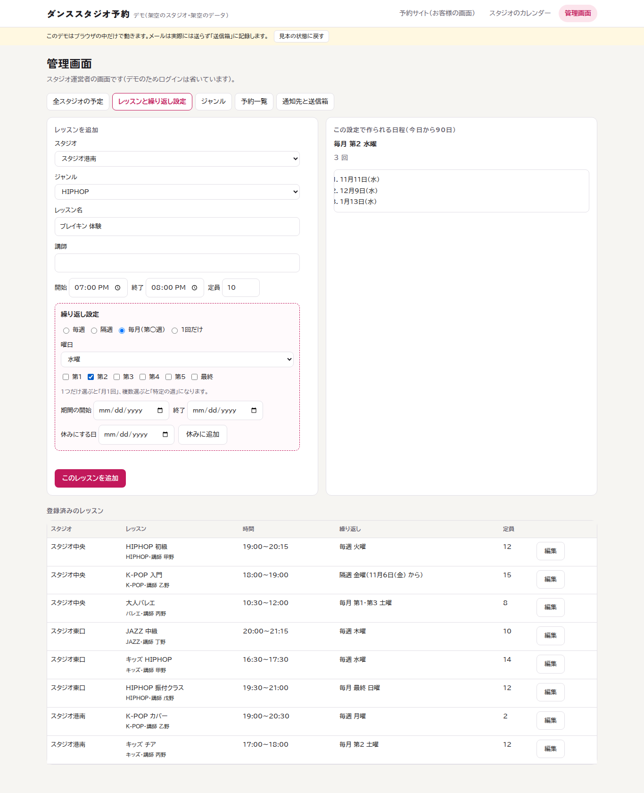

# ダンススタジオ予約サイト デモ

複数スタジオのレッスン予約（スタジオ → ジャンル → レッスン → 予約）と、管理画面での繰り返し日程（毎週・隔週・毎月 第◯週・1回だけ／期間・休みの日）の自動展開、スタジオ別・全スタジオのカレンダー、予約時の複数アドレスへの通知（デモの送信箱）を見せる画面デモです。

- データはすべて架空です。ブラウザの中だけで動き、メールは送信しません。
- 公開URL: https://ai-flow-architect.github.io/dance-studio-booking-demo/

